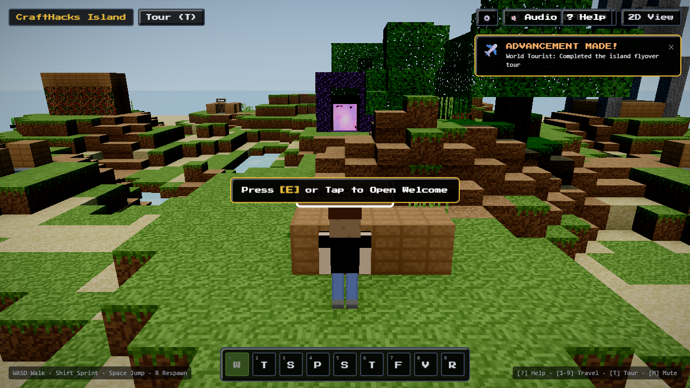
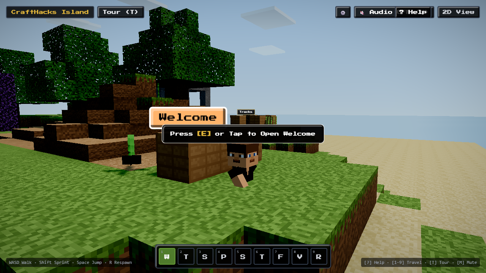
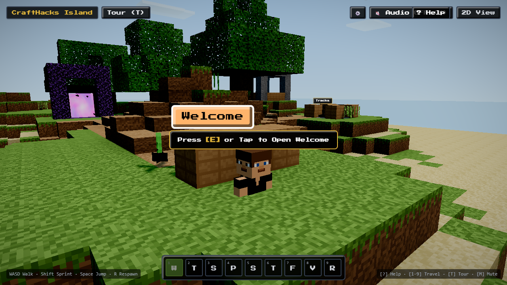
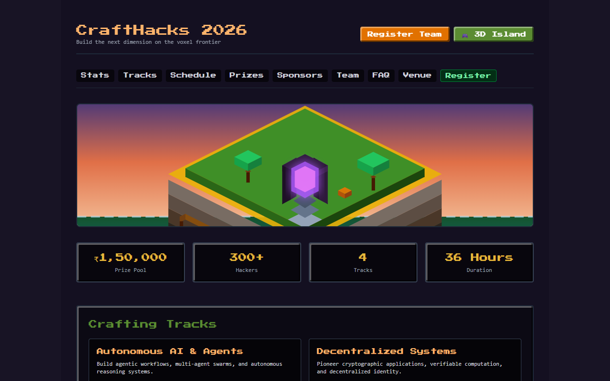

# Voxel Island ⛏️ — Interactive Hackathon Portal

[](https://nextjs.org/)
[](https://react.dev/)
[](https://threejs.org/)
[](https://rapier.rs/)
[](https://www.typescriptlang.org/)
[](https://tailwindcss.com/)
[](https://vitest.dev/)
[]()
[](LICENSE)

An immersive, voxel-crafted hackathon web experience built with **Next.js 15 App Router**, **React Three Fiber (R3F)**, and **Rapier Physics**. Explore the floating island, discover event tracks and schedule stations, and step through the glowing Nether Portal to register!

Designed from the ground up for authentic Minecraft aesthetic fidelity with **100% legal, procedural, and CC0/MIT assets** running on a **$0/month serverless stack**.

---

## 🌟 Key Features

- **Procedural 3D Voxel Island**: Custom chunk mesher (`lib/mesher.ts`) generating greedy-optimized voxel terrain with baked 3-neighbor Ambient Occlusion and realistic lush dripping grass side textures.
- **Authentic Player Character & 360° Orbit Camera**:
  - Full Steve pixel-art character model (cyan tunic, denim jeans, boots, and classic beard).
  - Third-person camera with 360° mouse drag orbit, scroll zoom, and camera-relative WASD locomotion.
  - Continuous collision detection (CCD) ensuring the player never falls through the blocks.
- **Interactive Nether Portal Registration Station**:
  - 4×5 Obsidian monolith with procedural purple vortex swirling energy shader.
  - Interactive registration form with real-time field validation (Zod + React Hook Form).
- **9 Discoverable Event Stations**:
  - *Welcome / Dock*, *Register (Nether Portal)*, *Tracks*, *Schedule*, *Prizes*, *Sponsors*, *Team*, *Venue*, and *FAQ*.
  - Pixel-art HUD with Station Tracker, Hotbar quick-teleport, and dynamic Compass needle.
- **Accessible 2D Fallback View**:
  - Full feature parity on `/2d` for users on low-power devices, screen readers, or without WebGL support.
  - Instant toggle between 3D Island and 2D view via the HUD switch.
- **Atmospheric Day/Night Cycle & Post-Processing**:
  - Realistic Minecraft azure daytime sky with pixelated floating voxel clouds and starry night transitions.
  - Adaptive performance tiering (GodRays, N8AO, Bloom) capped at 1.25 DPR for smooth 60 FPS on integrated GPUs.
- **Zero Mojang Copyright Violations**:
  - 100% procedural 16×16 canvas texture generation at runtime (`lib/textures.ts`).
  - Web Audio sound effects synthesized on-the-fly via **ZzFX** (zero external `.ogg`/`.mp3` downloads).

---

## 📸 Preview

| 3D Voxel Island & Steve Character | Obsidian Nether Portal Registration |
|---|---|
|  |  |

| 360° Orbit Camera & Hotbar Navigation | Accessible 2D Fallback Mode |
|---|---|
|  |  |

---

## 🎮 Controls

| Action | Keyboard / Mouse | Mobile Touch |
|---|---|---|
| **Move** | <kbd>W</kbd> <kbd>A</kbd> <kbd>S</kbd> <kbd>D</kbd> or Arrow Keys | Left Virtual Joystick |
| **Orbit Camera** | Left-click + drag across screen | Drag right half of screen |
| **Zoom Camera** | Mouse Wheel / Scroll | Pinch to zoom |
| **Jump** | <kbd>Space</kbd> | Tap Jump button |
| **Fast-Travel Hotbar** | Number keys <kbd>1</kbd> - <kbd>9</kbd> | Tap Hotbar slot |
| **Toggle 2D / 3D Mode** | Top HUD toggle button | Top HUD toggle button |
| **Open Help Overlay** | <kbd>H</kbd> key or '?' button | Tap '?' button |

---

## 🚀 Quickstart

### Prerequisites

- [Node.js](https://nodejs.org/) v20.x or higher
- [pnpm](https://pnpm.io/) v9.x or higher (`npm install -g pnpm`)

### 1. Clone the repository
```bash
git clone https://github.com/your-org/gdg_hackathon.git
cd gdg_hackathon
```

### 2. Install dependencies
```bash
pnpm install
```

### 3. Configure environment variables
Copy the template configuration file:
```bash
cp .env.example .env.local
```
*(The app runs out-of-the-box in local mock mode without external services).*

### 4. Run the development server
```bash
pnpm dev
```
Open [http://localhost:3000](http://localhost:3000) to explore the island!

---

## 🧪 Testing & Quality Assurance

We enforce a strict verification bar on all code changes:

```bash
# Run unit tests (Vitest)
pnpm test

# Run TypeScript typecheck
pnpm typecheck

# Run ESLint checks
pnpm lint

# Compile production build
pnpm build
```

---

## 🧱 Repository Structure

```
gdg_hackathon/
├── app/                  # Next.js 15 App Router pages & API routes
│   ├── 2d/               # Accessible 2D fallback view
│   ├── admin/            # Admin review & attendee management
│   ├── api/              # Registration, statistics, and health endpoints
│   └── code-of-conduct/  # Code of Conduct page
├── components/
│   ├── sections/         # Station modal content (Tracks, Prizes, Schedule)
│   ├── ui/               # Pixel-art HUD, Compass, Hotbar, Settings, Loading
│   └── world/            # 3D R3F components (Island, Player, Nether Portal, Sky)
├── content/              # Event JSON data validated via Zod schemas
├── docs/                 # Architectural Decision Records (ADRs)
├── lib/
│   ├── blocks.ts         # Block definitions & texture layer mapping
│   ├── island.ts         # Procedural voxel island layout & terrain
│   ├── mesher.ts         # Voxel chunk mesher with baked 3-neighbor AO
│   ├── quality.ts        # Dynamic GPU capability detection & DPR scaling
│   ├── sound.ts          # ZzFX procedural audio synthesizer
│   ├── store.ts          # Central Zustand state store
│   └── textures.ts       # 16x16 canvas texture generation
└── tests/
    └── unit/             # Automated Vitest test suites
```

---

## 🤝 Contributing

We welcome contributions from hackers, developers, and designers around the world!

Please read our comprehensive **[Contributing Guide](CONTRIBUTING.md)** for details on:
- Codebase architecture and invariants
- Mathematical voxel elevation & collider rules
- How to submit bug fixes and feature requests
- Conventional Commits and Pull Request review standards

All community members are expected to follow our **[Code of Conduct](CODE_OF_CONDUCT.md)**.

---

## 🛡️ Security

For vulnerability disclosure and security invariants, please review our **[Security Policy](SECURITY.md)**.

---

## 📜 Intellectual Property & Legal Notices

This project is an independent creation and is **not an official Minecraft product**. It is not approved by or associated with Mojang or Microsoft.

- **Textures**: Procedurally synthesized via 2D Canvas noise in code.
- **Audio**: Synthesized at runtime with ZzFX (MIT).
- **Fonts**: *Press Start 2P* by Cody Boisclair (SIL Open Font License 1.1).
- **Models**: Low-poly blocky meshes licensed under CC0 1.0 Universal.

See **[THIRD_PARTY_NOTICES.md](THIRD_PARTY_NOTICES.md)** for full licensing attributions.

---

Crafted with ❤️ for the Global Developer Community. Happy Hacking! ⛏️💎
