# Voxel Island Hackathon Site: Implementation Plan

Source: *Minecraft Hackathon Site — Repo Analysis* (Nov 9, 2026). This folder turns that analysis into a build plan you can work through phase by phase. Database: **Supabase**. Everything else follows the doc, with gaps filled in where the doc left a decision open (marked **Added**).

## What we are building

A hackathon website that is a small walkable voxel island. Visitors land at a dock at golden hour, walk a loop path, and open **stations** (a TV for sponsors, chests for prizes, a crafting table for tracks, a clock tower for the schedule, crew members for the team, a bookshelf for FAQ and rules, a map table for the venue). They register by walking into a **portal**, which opens a three-step form backed by Supabase. A **2D page** with exactly the same content is always one click away and loads automatically when WebGL fails or reduced motion is on.

The island is a website, not a sandbox: visitors can walk, run, jump, look, open stations and register. Nothing else.

## Phase index

| # | File | Ends with (something you can open in a browser) | Estimate (2–3 devs) |
|---|------|------|------|
| 0 | [phase-0-setup.md](phase-0-setup.md) | Next.js app on Vercel, empty canvas, store, validated content, `?debug` overlay, CI green, Supabase project linked | 2 days |
| 1 | [phase-1-island.md](phase-1-island.md) | Seeded voxel island with AO, trees, path, station pads, lit at golden hour, under 60 draw calls | 4 days |
| 2 | [phase-2-player.md](phase-2-player.md) | Third-person character walking the loop on desktop and phone; can't leave the island or get stuck | 3 days |
| 3 | [phase-3-stations.md](phase-3-stations.md) | All 9 stations open panels by walking + E, click/tap and hotbar; guided tour | 5 days |
| 4 | [phase-4-shaders-atmosphere.md](phase-4-shaders-atmosphere.md) | Water, wind, portal, sky dome, clouds, post stack, LUT grade, quality tiers | 4 days |
| 5 | [phase-5-registration-supabase.md](phase-5-registration-supabase.md) | Team registers through the portal; row in Supabase; code + email; admin export | 4 days |
| 6 | [phase-6-polish-accessibility.md](phase-6-polish-accessibility.md) | Loading screen, sound, toasts, full 2D fallback, keyboard and screen-reader pass, OG image | 3 days |
| 7 | [phase-7-performance-launch.md](phase-7-performance-launch.md) | Compressed assets, device matrix passed, load test passed, launched | 3 days |

Appendices (reference material used across phases):

| File | Contents |
|------|----------|
| [appendix-a-supabase-schema.md](appendix-a-supabase-schema.md) | Complete migrations, RLS, functions, pg_cron, pgTAP tests, generated types |
| [appendix-b-content-model.md](appendix-b-content-model.md) | Every content JSON file with its zod schema and the stations array |
| [appendix-c-player-rules.md](appendix-c-player-rules.md) | Every "players can't" rule, where it is enforced, and how to try to break it |
| [appendix-d-licensing-ip.md](appendix-d-licensing-ip.md) | What can be copied from which repo, banned assets, approved asset sources, notices |
| [appendix-e-testing-ci.md](appendix-e-testing-ci.md) | Test matrix per phase, GitHub Actions workflow, tooling setup |
| [appendix-f-ops-runbook.md](appendix-f-ops-runbook.md) | Environments, secrets, launch checklist, event-week runbook, data retention |

## Schedule: two parallel tracks (Added)

The doc's phases are numbered in build order for the 3D world, but registration and the 2D page do not depend on the 3D world. Run them in parallel so the site can **take registrations before the island is finished**. That removes the biggest launch risk.

```mermaid
gantt
  dateFormat  X
  axisFormat  Day %s
  section Track A: 3D world
  P0 Setup (shared)          :p0, 0, 2d
  P1 Island                  :p1, after p0, 4d
  P2 Player                  :p2, after p1, 3d
  P3 Stations (3D side)      :p3, after p2, 5d
  P4 Shaders                 :p4, after p3, 4d
  section Track B: content, 2D, backend
  Content + section components :b1, after p0, 3d
  2D page (milestone M1)       :b2, after b1, 2d
  P5 Registration + Supabase   :p5, after b1, 4d
  section Together
  P6 Polish + a11y            :p6, after p4, 3d
  P7 Perf + launch            :p7, after p6, 3d
```



| Milestone | When | What's live |
|---|---|---|
| **M1: Safety net** | ~Day 9 | `/2d` page with all real content + working registration. Could go public now. |
| **M2: Walkable** | ~Day 14 | Island + player + stations on preview deploys |
| **M3: Launch** | ~Day 24 | Full 3D experience; 2D remains as fallback |

Suggested split: **Dev A** (3D: phases 1, 2, 4 and the 3D half of 3), **Dev B** (content, section components, 2D page, phase 5, admin), **Dev C or shared** (art: textures, prefabs, Kenney character, LUT grade; phase 6 sound and a11y).

## Stack (from the doc, versions to pin at install)

| Layer | Choice | Notes |
|---|---|---|
| App + API | Next.js App Router + TypeScript, on **Vercel Hobby (free)** | One repo for 3D page, 2D page, API, admin |
| 3D | three.js + React Three Fiber **v9** (WebGL) + drei | Stay on WebGL: pmndrs postprocessing doesn't run on WebGPU; R3F v10 is alpha |
| Physics + player | @react-three/rapier + ecctrl | Plan B if ecctrl lags R3F v9: Rapier `KinematicCharacterController` (Phase 0 spike decides) |
| Rendering | @react-three/postprocessing, postprocessing, three-custom-shader-material | N8AO, Bloom, GodRays, AgX, LUT, SMAA |
| State | zustand | The single shared store |
| UI | Tailwind + 8bitcn/ui (shadcn/Radix underneath) | Radix Dialog gives focus trap for free |
| Fonts | Press Start 2P (Google Fonts, OFL), Monocraft (OFL, self-hosted) | Never the Minecraft fonts in any repo |
| Forms | react-hook-form + zod + @hookform/resolvers | One schema, client and server |
| Database | **Supabase Postgres (Free)** with RLS; Supabase Auth for admins; pg_cron for cleanup | Secret (service-role) key only on the server |
| Bot protection | Cloudflare Turnstile | Test keys in dev and staging |
| Email | **Added:** Resend (free tier) + React Email | One email per team; idempotency key per team code |
| Sound | ZzFX + Web Audio | No audio files to license |
| Art | Code-painted 16×16 textures, Kenney Blocky Characters (CC0), Blockbench | No Mojang assets |
| Tests | Vitest, Playwright, @axe-core/playwright, pgTAP (`supabase test db`), k6 | See Appendix E |
| Analytics | **Added:** Umami Cloud free tier (cookie-free) | Custom events: station opened, registered |

## Running cost: $0/month (free tiers only)

There is no paid plan, so every service below runs on its free tier. The plan is designed around each tier's limits.

| Service | Free tier used | Limit that matters | How the plan handles it |
|---|---|---|---|
| **Vercel Hobby** | Hosting, API routes, previews | Hobby is meant for non-commercial use; 100 GB bandwidth; function timeouts; image-optimization quota; no WAF rate-limit rules, no custom analytics events | Community GDG event fits. Keep the full 3D payload under ~5 MB so bandwidth lasts; serve images with `unoptimized` (pre-sized WebP); rate limiting is done in Postgres instead of the WAF. **If sponsors make it count as commercial:** deploy the same app to Cloudflare Workers free tier via the OpenNext adapter or to Netlify free (both allow commercial use). Nothing in the plan is Vercel-only. |
| **Supabase Free** | Postgres, Auth (admins), pg_cron | Project **pauses after 7 days without activity**; 500 MB DB; no PITR backups, no branching; 2 free projects | A free GitHub Actions cron pings `/api/status` (which queries the DB) every 3 days. Data is tiny (thousands of rows, a few MB). Project 1 = production, project 2 = staging/previews. Backups: scheduled encrypted `pg_dump` (Appendix F). |
| **Resend Free** | Confirmation emails | ~100 emails/day, 3,000/month, 1 domain | One email per team (all members in `to`), not one per member. Unsent emails stay `confirmation_sent_at is null` and a daily GitHub Actions job retries them. Fallback provider: Brevo free (300/day). |
| **Cloudflare Turnstile** | Bot checks | Free, unlimited | Test keys in dev and staging |
| **Umami Cloud Free** | Privacy-friendly analytics | Event volume cap | Track only two events: `station_open`, `registered` |
| **GitHub Actions** | CI, keep-alive cron, email retry, backup | 2,000 min/month on private repos (unlimited on public) | Lean CI: Playwright on Chromium only for PRs, full browser matrix only on `main` |
| **Domain** | `*.vercel.app` or a GDG-provided subdomain | — | A custom domain is the only optional cost |
| Tools | k6 (run locally), DaVinci Resolve (free) for the LUT, Blockbench, gltf-transform, Kenney CC0 assets | — | No paid SaaS anywhere |

## Architecture

```
┌──────────────────────── Browser: one Next.js page ─────────────────────────┐
│                                                                            │
│  3D world (R3F canvas)  ──state──▶  Game store (zustand)  ──state──▶  UI overlay (React DOM)
│  island mesh, player,   ◀─command──  nearbyStation        ◀─command──  hotbar, E prompt,
│  stations + sensors,                 openSection                       panels, register form,
│  shaders, post, tour                 playerTarget, timeOfDay           toasts, sound toggle
│        ▲                             qualityTier, soundOn                    ▲        │
│        └──────────── content/*.json + stations.ts (zod-validated) ──────────┘        │
└──────────────────────────────────────────────────────────────────────────────────┼───┘
                                                                     submit, result │
┌──────────── Server: Next.js on Vercel ────────────┐                               │
│  POST /api/register ── zod ─ rate limit ─ Turnstile ─▶ supabase.rpc('register_team')
│  GET  /api/status   (open/closed, team count, server time; cached 30 s)           │
│  /admin (Supabase Auth, RLS admin policy), /admin/export.csv                      │
└──────────────────────────────▶ Supabase Postgres: teams, team_members, event_settings,
                                   tracks, registration_attempts; RLS; no anon access
```

Rule: **the 3D world and the UI never import each other.** Both read and write the store. The registration form is the only client code that talks to the server (plus a read-only status fetch).

## Shared contracts (every phase uses these, keep them stable)

### Section IDs and hotbar

| Slot | `SectionId` | Station in the world | Panel content |
|---|---|---|---|
| 1 | `welcome` | Signboard at the dock | Hero: name, dates, countdown, stats, "Register" CTA |
| 2 | `tracks` | Crafting table | Tracks + open innovation |
| 3 | `schedule` | Clock tower | Live countdown, two-day timeline |
| 4 | `prizes` | Row of chests (one per tier) | Prize tiers, special prizes, swag |
| 5 | `sponsors` | TV with logo slideshow | Sponsor tiers, "Become a sponsor", deck link |
| 6 | `team` | Crew NPCs | Organizers, judges, mentors |
| 7 | `faq` | Bookshelf | FAQ, rules, code of conduct |
| 8 | `venue` | Map table / signpost | Venue, map, travel, contact |
| 9 | `register` | Portal | Three-step registration form |

### Store shape (`lib/store.ts`)

```ts
export type SectionId =
  | 'welcome' | 'tracks' | 'schedule' | 'prizes' | 'sponsors'
  | 'team' | 'faq' | 'venue' | 'register';
export type QualityTier = 'high' | 'medium' | 'low';
export type Stage = 'loading' | 'intro' | 'tour' | 'play';

export interface GameState {
  stage: Stage;
  nearbyStation: SectionId | null;   // set by sensors (3D) → read by prompt (UI)
  openSection: SectionId | null;     // set by E / click / hotbar → read by panel + world
  playerTarget: SectionId | null;    // set by hotbar (UI) → read by player (3D)
  typing: boolean;                   // a text field has focus
  formDirty: boolean;                // registration has unsaved input
  portalTransition: boolean;
  pendingNav: { kind: 'travel' | 'close'; to?: SectionId } | null; // "Leave registration?"
  visited: SectionId[];
  timeOfDay: number;                 // 0..1, 0.72 ≈ golden hour
  qualityTier: QualityTier;
  soundOn: boolean;                  // persisted, default false
  reducedMotion: boolean;
  tourSeen: boolean;                 // persisted
}

export const selectControlsDisabled = (s: GameState) =>
  s.stage !== 'play' || s.openSection !== null || s.typing || s.portalTransition;
```

Actions (`enterZone`, `leaveZone`, `open`, `close`, `travelTo`, `arrive`, `requestNav`, `confirmNav`, `cancelNav`, …) are specified in [Phase 0](phase-0-setup.md) and tested in Phase 3.

### Folder layout

```
app/
  layout.tsx               fonts, metadata, providers
  page.tsx                 SSR hero text + <Experience/> (dynamic, ssr:false)
  2d/page.tsx              2D page, same section components
  admin/                   login, dashboard (Supabase Auth)
  admin/export/route.ts    CSV export (admin only)
  api/register/route.ts    registration endpoint
  api/status/route.ts      registration open/closed + count + server time
content/                   event.json, tracks.json, schedule.json, prizes.json,
                           sponsors.json, team.json, faq.json, venue.json,
                           stations.ts, schemas.ts
components/
  world/                   Experience, Island, Water, Sky, Clouds, Station,
                           InteractZone, Portal, Player, Effects, TourCamera, prefabs/
  ui/                      Hotbar, Prompt, Panel, RegisterForm, Toast, LoadingScreen,
                           SoundToggle, ConfirmLeave, DebugOverlay
  sections/                Welcome, Tracks, Schedule, Prizes, Sponsors, Team, Faq,
                           Venue (pure content; used by panels AND the 2D page)
lib/
  store.ts  island.ts  mesher.ts  textures.ts  sound.ts  quality.ts  schema.ts
  supabase/server.ts  supabase/admin.ts  turnstile.ts  ratelimit.ts  email.ts
workers/island.worker.ts   island generation off the main thread
shaders/                   water, leaves, portal, sky, terrain
emails/                    ConfirmationEmail.tsx
supabase/migrations/       0001_… (Appendix A)
supabase/tests/            pgTAP tests
tests/unit/  tests/e2e/  tests/load/
public/models/ public/grade.cube public/sponsors/ public/fonts/
THIRD_PARTY_NOTICES.md
```

## Decisions to make before Phase 5 (fill these in)

| Decision | Placeholder used in this plan |
|---|---|
| Event name, dates, timezone, venue | `content/event.json` placeholders; timezone `Asia/Kolkata` |
| Register on our site or Devfolio? | Our site. If Devfolio, Phase 5 shrinks to "portal opens Devfolio in a new tab" |
| Team size | 2–4, exactly one leader |
| Max teams / waitlist | Unlimited (`max_teams = null`) |
| Team code prefix | `CRAFT` → `CRAFT-0001` |
| Email sending domain | `register@<your-domain>`, verified in Resend |
| Who are admins | Emails listed in Appendix F, given the `admin` role in Supabase |

## Done means (whole project)

- [ ] A team can register from the portal and appears in Supabase with a team code; every member gets a confirmation email.
- [ ] Every section is reachable by walking, by the hotbar, and on the 2D page.
- [ ] 60 fps on desktop at high quality; 30 fps on a mid-range phone at low.
- [ ] Every row of the testing matrix (Appendix E) passes.
- [ ] No Mojang textures, sounds, music, fonts or models anywhere in the build; `THIRD_PARTY_NOTICES.md` lists every MIT file adapted.
- [ ] No participant data in the repo, ever.
